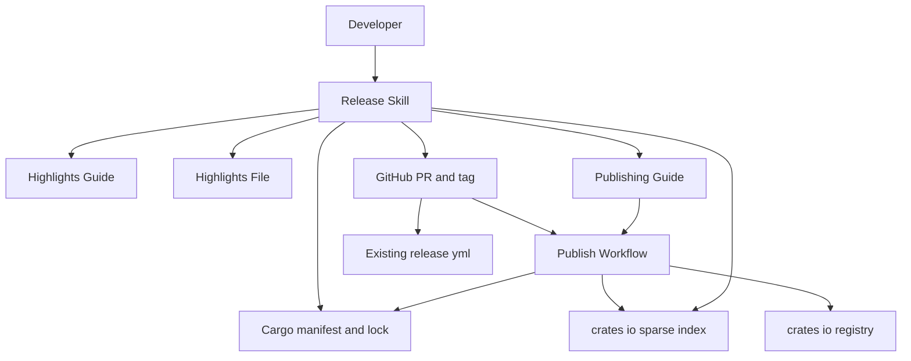
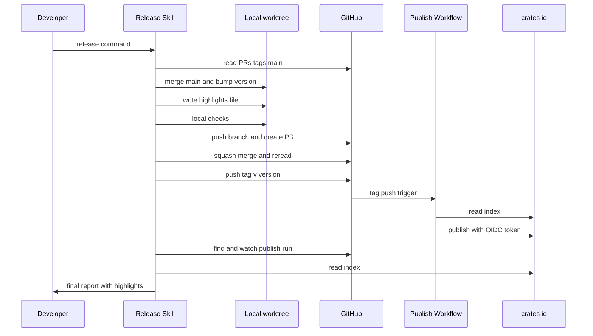
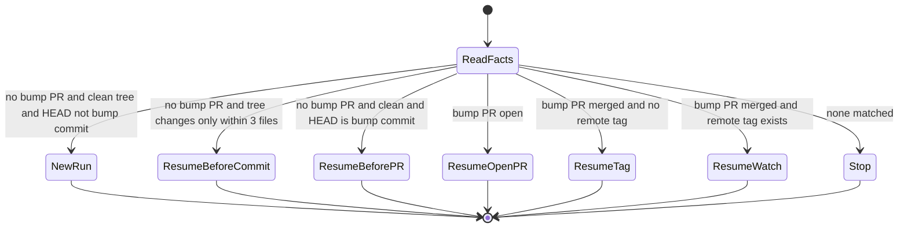
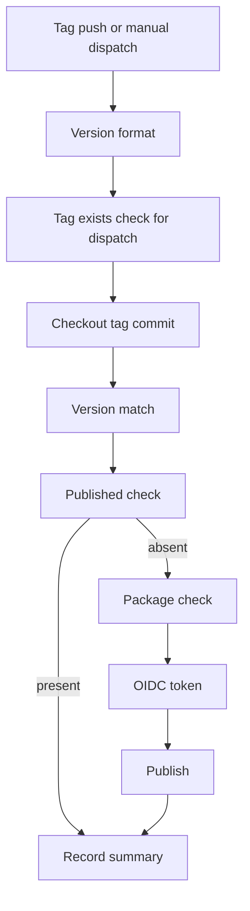

# Design Document: crates-io-release

## Overview

**Purpose**: 本フィーチャーは、gtd-mcp のリリース 1 回分（版上げから crates.io への公開確認まで）を、開発者の承認待ち無しに安全に回す仕組みを提供する。手作業の版上げ・タグ打ち・手元のトークンでの `cargo publish` を、`/release` スキルと、タグの push で Trusted Publishing（OIDC）により冪等に公開する CI ワークフロー 1 本に置き換える。

**Users**: gtd-mcp の開発者（ekicyou）が `/release` を打ち、最終報告で見どころを読む。gtd-mcp の利用者は crates.io の包みと `doc/release-notes/` の見どころを読む。

**Impact**: リポジトリに 5 ファイル（スキル 2・ワークフロー 1・文書 2）を新設し、既存の 4 ファイル（`Cargo.toml`・`RELEASE.md`・`README.md`・`README.ja-jp.md`）を一度だけ小さく直す。Rust のソースコード、既存の `ci.yml`・`release.yml`・`security-audit.yml` は変更しない。

### Goals
- `/release`（引数省略で 3 つ目の数字 +1、または `X.Y.Z`）の 1 回で、版上げ → 見どころ → 手元の確かめ → 版上げ PR → squash マージ → タグ push → 公開の見守り → 最終報告が止まらずに回る。
- タグ `v{版}` の push で、長期の鍵を使わずに crates.io へ公開される。同じ版の起動し直しは安全（公開済みなら鍵を取らずに緑で終わる）。
- crates.io の版・Git のタグ・`Cargo.toml` の版が必ず一致する。
- crates.io に上がる包みが、ビルドと利用に要るファイルだけになる。

### Non-Goals
- 既存の `release.yml`（バイナリ配布・GitHub Release 作成）の変更・見守り・待ち合わせ。
- GitHub Release の本文を見どころから作る仕組み、Release の資産の検査。
- 過去の版（0.8.1〜0.8.3）のタグ・見どころの後追い作成。
- areka 固有の道具（`tools/*.ps1`）・zip 梱包・起動確認・ライセンス表・winget の移植。
- crates.io の画面操作、開発者の Claude Code 設定ファイルの書き換え。

## Boundary Commitments

### This Spec Owns
- **リリース 1 回分の手順**（`.claude/skills/release/`）: 前提の確かめ・版上げ・見どころの作成・手元の確かめ・版上げ PR・squash マージ・タグの push・公開の走りの見守り・最終報告・再開・公開後の見どころの直し。
- **crates.io への公開の走り**（`.github/workflows/crates-io.yml`）: きっかけ・版の確かめ・公開済み判定・包む確かめ・鍵の受け取り・公開・記録。
- **「crates.io に `gtd-mcp` {版} が在るか」の判定の定義**（公開済み判定の契約。スキル・ワークフロー・文書が同じ定義を使う）。
- **見どころファイルの形の決まり**（`doc/release-notes/README.md`）と、見どころファイルの置き場 `doc/release-notes/v{版}.md` の命名。
- **crates.io 側の設定と運用の文書**（`doc/crates-io-publish.md`）。
- **crates.io に上がる包みの範囲**（`Cargo.toml` の `include`。このフィーチャーの実装で 1 回だけ設定する）。
- **`RELEASE.md` の凍結の注記**と、`README.md`・`README.ja-jp.md` の `RELEASE.md` への案内 1 行ずつ。

### Out of Boundary
- `release.yml`・`ci.yml`・`security-audit.yml`・`dependabot.yml` の中身。`release.yml` の走りの結果は Release Skill の合否にも Publish Workflow の前提にも入れない。
- Rust のソースコード・テスト・依存の版。
- crates.io の Trusted Publisher の登録操作（開発者が画面で行う。本 spec は手順の案内まで）。
- 開発者の `settings.json`（本 spec は許可ルールの文例を示すだけ）。
- 版上げ PR での `include` の変更（版上げ PR は版の置き場と見どころファイル以外を触らない）。

### Allowed Dependencies
- **Release Skill → 外部**: 開発者の手元の `git`・認証済みの `gh`（2.x）・`cargo`（stable）・`curl`。crates.io の sparse index（`https://index.crates.io/gt/d-/gtd-mcp`）の読み取り。
- **Release Skill → 本 spec の他の成果物**: Highlights Guide（書き方の正本として読む）、Publishing Guide（赤の切り分けの正本として指す）、Publish Workflow（ファイル名 `crates-io.yml` で走りを読むだけ。書き換えない）。
- **Publish Workflow → 外部**: GitHub Actions の `ubuntu-latest` ランナー、`actions/checkout`、`rust-lang/crates-io-auth-action@v1`、ランナーに在る `rustup`・`cargo`・`curl`・`jq`・`git`、crates.io の sparse index と公開 API。
- **禁止**: Publish Workflow から `release.yml` の呼び出し・待ち合わせ・状態の読み取り。`secrets.` の参照。Release Skill から手元の `cargo publish`・`gh run rerun`・ワークフローやソースの書き換え。新しいスクリプトファイルの追加。

### Revalidation Triggers
- ワークフローのファイル名 `crates-io.yml` の変更（crates.io の Trusted Publisher 設定と Publishing Guide の値を同時に直す必要がある）。
- きっかけ（タグ `v*` の push・`workflow_dispatch` の入力 `version`）や段の名前の変更（Release Skill の走りの見つけ方と Publishing Guide の切り分け表が依存する）。
- 版の置き場の変更（`Cargo.toml` の `[package] version` 1 行・`Cargo.lock` の 1 行。ワークスペース化・クレートの追加を含む）。
- 見どころファイルの置き場・名前・形の決まりの変更（Release Skill の形の確かめが依存する）。
- `release.yml` を待ち合わせる方針への変更、GitHub Release 本文の自動化の導入。
- 公開済み判定の情報源（sparse index）の変更。

## Architecture

### Existing Architecture Analysis
- 版の置き場は `Cargo.toml` の `[package] version`（`0.8.3`）と `Cargo.lock` の `name = "gtd-mcp"` 直後の `version` 行の 2 か所。単一クレート（lib `gtd_mcp` + bin `gtd-mcp`）。
- `Cargo.lock` は追跡済み（`dbe9713`）で、`--locked` を前提にできる。
- 既存の CI は `ubuntu-latest` を中心に `actions/checkout@v5` を使う。`release.yml` はタグ `v*` の push で走り、本 spec の Publish Workflow と並走する。
- main はブランチ保護が無い。`dependabot.yml` は毎週 `Cargo.toml`・`Cargo.lock` を変更する PR を開きうるが、作者が `dependabot[bot]` の PR は要件 2.5 の止まり条件から外す（設計判断 9）。`rebase-strategy: auto` なので版上げの後の衝突も dependabot が自分で直す。
- `Cargo.toml` に `include`/`exclude` が無く、現状の包みに `.claude/`・`.kiro/`・`.github/`・`CLAUDE.md`・`doc/`・`tests/` 等が入る。
- `src/` に `include_str!` 等の外部ファイル参照は無い（`src/**/*.rs` だけでビルドできる）。

### Architecture Pattern & Boundary Map

選んだ形は「新設のみ・判定は各ファイルの中に直接書く」（research.md の案 B）。スキルとワークフローは互いを呼ばず、公開済み判定の契約と見どころの形の契約だけを共有する。



**Architecture Integration**:
- Selected pattern: 手順書駆動のエージェントスキル＋イベント駆動の CI ジョブ 1 本。areka の本番運用中の形を、単一クレート・crates.io のみへ削って流用する。
- Domain/feature boundaries: スキルは「手元とリポジトリの状態を変え、走りの結果を読む」側、ワークフローは「タグのコミットを crates.io へ出す」側。境目は Git のタグ `v{版}` と、ワークフロー名 `crates-io.yml` の走り。
- Existing patterns preserved: steering の CI チェック 5 種、`ubuntu-latest`、`actions/checkout@v5`、`Cargo.lock` 追跡、squash マージ。
- New components rationale: 6 成果物はそれぞれ要件の 1 主語に 1 対 1 で対応し、統合・分割の余地が無い。
- Steering compliance: 文書の言語の使い分け（スキル・手順書・設定文書は日本語、見どころと README は英語）、`tech.md` の CI チェックを手元の確かめの基準にする。

**Dependency direction**: `gtd-mcp package`（`Cargo.toml`） ← `Publish Workflow` ← `Publishing Guide` ← `Release Skill`、および `Highlights Guide` ← `Release Skill`。矢印の右側は左側だけを参照する。Release Skill は全部を読むが誰からも参照されず、Publish Workflow は文書もスキルも参照せず、Highlights Guide は他の成果物を参照しない。逆向きの参照（例: ワークフローがスキルの手順や文書に依存する）は誤りとして扱う。

### Technology Stack

| Layer | Choice / Version | Role in Feature | Notes |
|-------|------------------|-----------------|-------|
| Agent procedure | Claude Code スキル（`SKILL.md` + `procedure.md`） | リリース手順の正本と約束 | `disable-model-invocation: true` で明示実行のみ |
| Local CLI | `git`・`gh` 2.x・`cargo`（stable）・`curl` | 版上げ・確かめ・PR・タグ・走りの読み取り | 新しい道具は足さない。`cargo-edit` にも依存しない |
| CI runtime | GitHub Actions `ubuntu-latest`・bash | 公開の走り | 既存 CI と同じ OS。確定（設計判断 1） |
| CI actions | `actions/checkout@v5`・`rust-lang/crates-io-auth-action@v1` | 取り出し・OIDC で短命の鍵 | checkout は既存 `ci.yml` と同じ版 |
| Registry | crates.io sparse index（`https://index.crates.io/gt/d-/gtd-mcp`） | 公開済み判定 | 1 行 1 版の JSON |
| Packaging | `Cargo.toml` の `include` | 包みの範囲 | 一度きりの変更 |

## File Structure Plan

### Directory Structure
```
.claude/skills/release/
├── SKILL.md          # 約束（してはいけない事・止まり方）と段の要約。frontmatter で明示実行のみ
└── procedure.md      # 手順の正本: 読み方・段 1〜7・再開の表・見どころの直し・見直すきっかけ・開発者の設定
.github/workflows/
└── crates-io.yml     # 公開の走り: 版の形 → タグの確かめ → 取り出し → 版の一致 → 公開済み判定 → 包む確かめ → 鍵 → 公開 → 記録
doc/
├── crates-io-publish.md   # 日本語: Trusted Publisher 登録・いつもの流れ・確かめ方・切り分けとやり直し・予備の手順・してはいけない操作
└── release-notes/
    └── README.md          # 英語: 見どころファイルの置き場・形・参照の書き方・必ず載せるもの・書かないもの・形の確かめ
```
`doc/release-notes/v{版}.md` はリリースのたびに Release Skill が作る実行時の成果物であり、本フィーチャーの実装では作らない。

### Modified Files
- `Cargo.toml` — `[package]` に `include = ["src/**/*.rs", "Cargo.toml", "Cargo.lock", "/README.md", "LICENSE"]` を足す（要件 16。確定: 設計判断 6）。他の行は変えない。
- `RELEASE.md` — 1 行目の `# Release Notes` の直後に、英語の凍結の注記（引用ブロック 1 つ）を足す。既存の本文は 1 字も変えない（要件 15.1, 15.2）。
- `README.md` — 199 行目の `RELEASE.md` の案内 1 行を、英語で「v0.8.0 までは `RELEASE.md`、以後は `doc/release-notes/` と GitHub Releases」に直す（要件 15.3）。
- `README.ja-jp.md` — 213 行目の同じ案内 1 行を日本語で直す（要件 15.3）。

## System Flows

### リリース 1 回分（順調な経路）



- 開発者の承認を挟む所は無い。止まるのは「止まり方の決まり」（後述 Error Handling）に当たったときだけ。
- 取り消せない操作（squash マージ・タグの push）の直前には必ず読み直しの判定を置き、判定はコマンドの出力を取り直して行う。

### 再開の判定（段 1 の前）



各状態の始める段は「Release Skill」の State Management の表が正本である。

### 公開の走り（Publish Workflow）



- どの段が失敗しても、以降は「記録」以外を飛ばす。「記録」は必ず走り、crates.io での {版} の有無を要約に書く。
- 公開済みのときは「包む確かめ」「鍵」「公開」を飛ばし、鍵を取らずに緑で終わる。

## Requirements Traceability

| Requirement | Summary | Components | Interfaces | Flows |
|-------------|---------|------------|------------|-------|
| 1.1, 1.2, 1.3, 1.4 | 次の版の決定と形の検査 | Release Skill | 段 1.4 | リリース 1 回分 |
| 1.5 | 見どころの直しの頼みでは段を回さない | Release Skill | 見どころの直し | — |
| 1.6 | 明示実行のみ | Release Skill | `SKILL.md` frontmatter | — |
| 2.1, 2.2, 2.3, 2.4 | 枝・作業木・main の取り込み・確かめた main | Release Skill | 段 1.1 | リリース 1 回分 |
| 2.5 | 版の置き場を触る開いた PR | Release Skill | 段 1.2 | — |
| 2.6 | `v{版}` の不在 | Release Skill | 段 1.4 | — |
| 2.7, 2.8, 2.9 | 前のタグの確かめと初回の緩め | Release Skill | 段 1.3・公開済み判定の契約 | — |
| 3.1 | 版の置き場 2 か所だけを変える | Release Skill | 段 2.1 | — |
| 3.2, 3.3, 3.4, 3.5 | 変更一覧の起点・見どころの作成と読み直し | Release Skill, Highlights Guide | 段 2.2・見どころの形の契約 | — |
| 4.1, 4.2 | CI と同じ確かめ・公開前の確かめ | Release Skill | 段 3.3, 3.4 | — |
| 4.3 | 差分の範囲 | Release Skill | 段 3.1 | — |
| 4.4 | 見どころの形 | Release Skill, Highlights Guide | 段 3.2・見どころの形の契約 | — |
| 4.5, 4.6 | 欠けたら PR を出さず止まる・自動修正しない | Release Skill | 段 3・止まり方の決まり | — |
| 5.1, 5.2, 5.3 | コミット・PR・PR のファイルの読み直し | Release Skill | 段 4.1, 4.2 | リリース 1 回分 |
| 5.4 | main が動いたときの取り込みと確かめ直し | Release Skill | 段 4.3 | — |
| 5.5, 5.6, 5.7 | CI を待たない squash マージと読み直し | Release Skill | 段 4.4 | リリース 1 回分 |
| 6.1, 6.2, 6.3, 6.4, 6.5, 6.6 | タグの確かめ・1 本だけの push・読み直し | Release Skill | 段 5 | リリース 1 回分 |
| 7.1, 7.2 | 公開の走りの特定と待ち | Release Skill | 段 6.1 | リリース 1 回分 |
| 7.3, 7.7 | 緑の判定（再開時は同じ版の手動の走りも認める） | Release Skill, Publish Workflow | 段 6.2・公開済み判定の契約・`run-name` | — |
| 7.4, 7.5, 7.6 | 赤の扱い | Release Skill, Publishing Guide | 段 6.3・切り分け表 | — |
| 8.1, 8.2, 8.3, 8.4, 8.5, 8.6 | 最終報告 | Release Skill | 段 7 | — |
| 9.1, 9.2, 9.3, 9.4 | 再開の判定 | Release Skill | 再開の表 | 再開の判定 |
| 9.5, 9.6, 9.7, 9.8, 9.9 | 止まり方・外へ出るコマンド・印字禁止・書き換え禁止 | Release Skill | 読み方・してはいけない事・止まり方の決まり | — |
| 9.10 | 許可ルールの文例 | Release Skill | 開発者の設定 | — |
| 10.1, 10.2 | 公開後の見どころの直し | Release Skill | 見どころの直し | — |
| 11.1, 11.2 | きっかけ | Publish Workflow | `on:` | 公開の走り |
| 11.3, 11.6 | 版の形の確かめと値の埋め込み禁止 | Publish Workflow | 段「版の形」 | 公開の走り |
| 11.4 | 版の一致 | Publish Workflow | 段「版の一致」 | 公開の走り |
| 11.5 | 手動起動のタグの存在 | Publish Workflow | 段「タグの確かめ」 | 公開の走り |
| 11.7 | 他のワークフローをきっかけにしない | Publish Workflow | `on:` | — |
| 12.1, 12.2 | 公開済み判定と飛ばし | Publish Workflow | 段「公開済み判定」・公開済み判定の契約 | 公開の走り |
| 12.3, 12.4 | 包む確かめ・鍵・公開と失敗の段 | Publish Workflow | 段「包む確かめ」「鍵」「公開」 | 公開の走り |
| 12.5 | 記録 | Publish Workflow | 段「記録」 | 公開の走り |
| 12.6, 12.7 | Secrets 不使用・最小権限 | Publish Workflow | `permissions:` | — |
| 12.8 | 直列化 | Publish Workflow | `concurrency:` | — |
| 12.9 | `release.yml` と独立（待ち合わせない） | Publish Workflow | — | — |
| 13.1, 13.2 | Trusted Publisher の登録と順序 | Publishing Guide | 2 節 | — |
| 13.3 | いつもの流れと確かめ方 | Publishing Guide | 3・4 節 | — |
| 13.4 | 切り分けとやり直し | Publishing Guide | 5 節 | — |
| 13.5 | 予備の手順 | Publishing Guide | 6 節 | — |
| 13.6 | してはいけない操作 | Publishing Guide | 7 節 | — |
| 13.7 | 日本語 | Publishing Guide | — | — |
| 14.1, 14.2, 14.3, 14.4, 14.5 | 見どころの決まり | Highlights Guide | 見どころの形の契約 | — |
| 15.1, 15.2, 15.3 | `RELEASE.md` の凍結と README の案内 | Release History Note | — | — |
| 16.1, 16.2, 16.3 | 包みの範囲 | gtd-mcp package | `include` | — |

## Components and Interfaces

| Component | Domain/Layer | Intent | Req Coverage | Key Dependencies (P0/P1) | Contracts |
|-----------|--------------|--------|--------------|--------------------------|-----------|
| Release Skill | 手順（手元） | リリース 1 回分を承認待ち無しで回す | 1〜10 | gh・git・cargo (P0), Highlights Guide (P0), Publish Workflow の走り (P0), Publishing Guide (P1) | Service, State |
| Publish Workflow | CI | タグのコミットを crates.io へ冪等に公開する | 11, 12 | crates-io-auth-action (P0), sparse index (P0), gtd-mcp package (P0) | Batch |
| Publishing Guide | 文書 | crates.io の設定・運用・やり直し・予備の手順 | 13 | Publish Workflow の段の名前 (P0) | — |
| Highlights Guide | 文書 | 見どころファイルの形の正本 | 14 | — | 見どころの形の契約 |
| Release History Note | 文書 | `RELEASE.md` の凍結と案内 | 15 | — | — |
| gtd-mcp package | ビルド設定 | 包みの範囲を絞る | 16 | cargo (P0) | — |

### 共有の契約

#### 公開済み判定の契約（Release Skill・Publish Workflow・Publishing Guide が共有）
- **入力**: 版 `V`（`^[0-9]+\.[0-9]+\.[0-9]+$` を満たす文字列）。
- **情報源**: `https://index.crates.io/gt/d-/gtd-mcp`（sparse index。1 行が 1 版の JSON）。
- **結果**（3 値）:
  - `present`: 取得が成功し、`vers` が `V` と字のとおり一致する行が 1 行以上在る（`yanked` の値は問わない。取り下げ済みの版も再公開できないため）。
  - `absent`: 取得が成功し、一致する行が無い。
  - `unreadable`: 取得が失敗した（HTTP の失敗・通信の失敗）。`absent` と取り違えない。
- **利用箇所**: Release Skill 段 1.3（`{旧版}` が在るか: 要件 2.8）・段 6.2（`{版}` が在るか: 要件 7.3）、Publish Workflow の「公開済み判定」「記録」（要件 12.1, 12.2, 12.5）、Publishing Guide 4 節（確かめ方: 要件 13.3）。
- **既知の制約**: 公開直後は索引の反映に遅れがある。Publish Workflow の「記録」は有限の待ちを持つ（後述）。Release Skill は `absent` を見たら即座に赤とせず、段 6.2 の上限まで読み直す。

#### 見どころの形の契約（Highlights Guide が定め、Release Skill が確かめる）
- 置き場: `doc/release-notes/v{版}.md`、版ごとに 1 つ、UTF-8、改行は LF。
- 中身: ASCII 文字だけ（英語・普通の文体の機械的な代理。確定: 設計判断 5）。
- 見出し: `#`・`##` の見出しを使わない。`### ` で始まる行が 1 行以上在り、`### ` の行はすべて見どころの見出し。
- 見出しの末尾: 元になった変更への参照を `(...)` で置く。参照 1 つは `#{PR 番号}` か、PR を持たない直接のコミットの 7 桁の短い SHA。複数は `, `（コンマと空白 1 つ）で区切る。正規表現: `^### .+ \((#[0-9]+|[0-9a-f]{7})(, (#[0-9]+|[0-9a-f]{7}))*\)$`（確定: 設計判断 4）。
- 機械で見ない物（書いた側が読み直す）: 英語・普通の文体であること、「必ず載せるもの」が全部載っていること、「書かないもの」が無いこと。

### 手順（手元）

#### Release Skill

| Field | Detail |
|-------|--------|
| Intent | `/release` の 1 回で、版上げから公開確認・最終報告までを止まらずに回す |
| Requirements | 1.1, 1.2, 1.3, 1.4, 1.5, 1.6, 2.1, 2.2, 2.3, 2.4, 2.5, 2.6, 2.7, 2.8, 2.9, 3.1, 3.2, 3.3, 3.4, 3.5, 4.1, 4.2, 4.3, 4.4, 4.5, 4.6, 5.1, 5.2, 5.3, 5.4, 5.5, 5.6, 5.7, 6.1, 6.2, 6.3, 6.4, 6.5, 6.6, 7.1, 7.2, 7.3, 7.4, 7.5, 7.6, 7.7, 8.1, 8.2, 8.3, 8.4, 8.5, 8.6, 9.1, 9.2, 9.3, 9.4, 9.5, 9.6, 9.7, 9.8, 9.9, 9.10, 10.1, 10.2 |

**Responsibilities & Constraints**
- `SKILL.md` は約束（Core Task・段の要約・Rules）だけを持ち、段・コマンド・判定・表は `procedure.md` が正本（areka と同じ分担）。frontmatter に `disable-model-invocation: true` と `argument-hint: '[X.Y.Z]'` を置く（1.6）。
- 主文脈で実行する。サブエージェント・進み具合のファイル・記録用のコミットを作らない（8.6）。判定はコマンドの出力を主文脈が読んで表に当てはめる。スクリプトは足さない。
- 置き換える語: `{remote}`（`git remote` の名前。`-v` は付けない）・`{枝}`・`{版}`・`{旧版}`・`{sha}`（squash のコミット）・`{確かめた main}`・`{番号}`（PR）・`{id}`（走り）・`{起点}`（変更一覧の起点）。
- `git fetch`・`git push`・`git ls-remote` には `--quiet` を付け、標準エラーは捨てる。成否は終了コードと読み直しで決める（9.8: 接続先 URL を印字しない）。
- 外へ出るコマンド（`git push`・`gh pr create`・`gh pr merge`）は 1 回の呼び出しにつき単独の 1 行（9.7）。

**Dependencies**
- Inbound: 開発者 — `/release [X.Y.Z]` と、見どころの直しの頼み (P0)
- Outbound: Highlights Guide — 書き方の正本 (P0)。Publishing Guide — 赤の切り分け表 (P1)
- External: `gh`（PR・走りの読み取りとマージ）(P0)、`git` (P0)、`cargo` (P0)、`curl`（sparse index）(P1)

**Contracts**: Service [x] / State [x]

##### Service Interface（段と判定）

`procedure.md` の段の構成と各段の判定を次のとおり定める。コマンドは代表形であり、`procedure.md` に正確な形で書く。

| 段 | 行うこと | 判定（当たらなければ止まる） | 要件 |
|---|---|---|---|
| 0 再開の読み方 | State Management の表で始める段を決める | どれかの行に当たる | 9.1〜9.4 |
| 1.1 枝・作業木・main | `git branch --show-current` が `main` でない。`git status --porcelain` が 0 行。`git fetch --quiet {remote} main` → 必要なら `git merge {remote}/main`。`git diff --name-only {remote}/main...HEAD` が 0 件。`git rev-parse {remote}/main` を `{確かめた main}` に覚える | 3 つ全部が当たる。`main` なら「ハーネスのワークツリーの枝で打ち直す」と示す | 2.1, 2.2, 2.3, 2.4 |
| 1.2 開いた PR | `gh pr list --state open --limit 200 --json number,title,files,author` で、`author.login` が `app/dependabot` の PR を除き、`files` に `Cargo.toml` か `Cargo.lock`（根）を持つ PR を数える（`files` が 100 件の PR は `gh pr diff {番号} --name-only` で読み直す） | 0 本。在れば番号と題を示す | 2.5 |
| 1.3 旧版と前のタグ | `git show HEAD:Cargo.toml` の `[package] version` を `{旧版}` とする。`git ls-remote --quiet --tags {remote} refs/tags/v{旧版}` を読む。1 行なら `{起点}`＝`v{旧版}`。0 行なら `gh pr list --state merged --search "chore(release): v{旧版} in:title" --json number,title,mergeCommit` と公開済み判定（`{旧版}`）を読み、下の 3 分岐に当てはめる | 下の分岐表 | 2.7, 2.8, 2.9 |
| 1.4 次の版 | 引数なしは `{旧版}` の 3 つ目 +1。引数は先頭の `v` を除く。形 `^[0-9]+\.[0-9]+\.[0-9]+$`。`{版}` > `{旧版}`（数 3 つを数として比べる）。`git ls-remote --quiet --tags {remote} refs/tags/v{版}` が 0 行 | 全部が当たる。形の外れは受け付ける形を、版の外れは 2 つの版を示す。何も変更していない | 1.1, 1.2, 1.3, 1.4, 2.6 |
| 2.1 版上げ | `Cargo.toml` の `version = "{旧版}"` 1 行を Edit で `{版}` に直し、`cargo update --workspace` で `Cargo.lock` の 1 行を揃える | `Cargo.toml` の版が `{版}`。範囲の判定は 3.1 が持つ | 3.1 |
| 2.2 見どころ | `{起点}` がタグ `v{旧版}` のときは先に `git fetch --quiet {remote} refs/tags/v{旧版}:refs/tags/v{旧版}` で手元に取る。`git log --first-parent --format="%h %s" {起点}..{確かめた main}` で変更の一覧を読み、Highlights Guide に従って `doc/release-notes/v{版}.md` を新しく書き、「Must include」を読み直す | ファイルが在り、読み直しで漏れが無い | 3.2, 3.3, 3.4, 3.5 |
| 3.1 差分の範囲 | `git diff --numstat HEAD`・`git diff -U0 HEAD -- Cargo.toml`・`git diff -U0 HEAD -- Cargo.lock`・`git status --porcelain` | 変更は `Cargo.toml`・`Cargo.lock` だけで、各々 消 1 行 `version = "{旧版}"`・足 1 行 `version = "{版}"`。新しいファイルは `doc/release-notes/v{版}.md` の 1 行だけ | 4.3, 3.4 |
| 3.2 見どころの形 | 見どころの形の契約を `grep` で確かめる（`### ` 行が 1 以上・`^#{1,2} ` 行が 0・`### ` 行がすべて参照の正規表現に合う・非 ASCII の行が 0） | 4 つとも当たる。外れた項目と行番号を示す | 4.4 |
| 3.3 CI と同じ確かめ | steering `tech.md` の 5 コマンド（`cargo fmt --all -- --check`・`cargo clippy --all-targets --all-features -- -D warnings`・`cargo build --verbose`・`cargo test --verbose`・`cargo build --release --verbose`）を 1 つずつ順に | 5 つとも終了コード 0。整形の自動修正（`cargo fmt --all`）はしない | 4.1, 4.6 |
| 3.4 公開前の確かめ | `cargo publish --dry-run --locked --allow-dirty` | 終了コード 0（確定: 設計判断 10） | 4.2 |
| 4.1 コミットと PR | `git add Cargo.toml Cargo.lock doc/release-notes/v{版}.md` → 題 `chore(release): v{版}` でコミット → `git push --quiet {remote} HEAD` → `gh pr create --base main --title "chore(release): v{版}" --body-file …`。本文に版・変更ファイル（`--numstat`）・3.1〜3.4 の結果・見どころの所在 | PR が開いた | 5.1, 5.3, 5.7 |
| 4.2 PR のファイル | `gh pr view {番号} --json files` | 3 ファイルだけ | 5.2 |
| 4.3 main の移動 | `git fetch --quiet {remote} main`。先端が `{確かめた main}` と違えば: 新しく入った題を `git log --first-parent --format="%h %s" {確かめた main}..{remote}/main` で控える → `git merge {remote}/main` → 「Must include」に当たる物が在れば見どころに足して 3.2 を回し、見どころだけのコミットを足す → 3.3・3.4 を回し直す → 3.1 を `{remote}/main` 相手に読み替えて回し直す → push → 4.2 を回し直す → `{確かめた main}` を覚え直す | 先端が `{確かめた main}` と同じ | 5.4 |
| 4.4 squash マージ | 直前にもう一度 4.3 の fetch。`gh pr merge {番号} --squash`（`--delete-branch` なし）。PR の CI は待たない | `gh pr view {番号} --json state,mergeCommit` が `MERGED` と squash のコミットを返す。これだけでマージの成否を決め、`{sha}` を覚える | 5.5, 5.6 |
| 5.1 タグの確かめ | `git fetch --quiet {remote} main` → `git merge-base --is-ancestor {sha} {remote}/main` が 0。`git show {sha}:Cargo.toml` の版が `{版}`。`git ls-remote --quiet --tags {remote} refs/tags/v{版}` が 0 行。手元の `refs/tags/v{版}` が無いか `{sha}` を指す | 4 つとも当たる。手元のタグが別のコミットなら止まり、消さない | 6.1, 6.2 |
| 5.2 タグの push | 手元に無ければ `git tag v{版} {sha}`（注釈なし）。`git push --quiet {remote} refs/tags/v{版}` | `git ls-remote --quiet --tags {remote} refs/tags/v{版}` が `{sha}` を返す | 6.1, 6.3, 6.4, 6.5 |
| 6.1 走りの特定と待ち | `gh run list --workflow crates-io.yml --event push --json databaseId,headSha,headBranch,status,conclusion` から `headBranch`＝`v{版}` かつ `headSha`＝`{sha}` の走りを取る（30 秒ごと最長 5 分）。`gh run watch {id} --exit-status --interval 30` を裏で回して待つ | 走りが見つかり、`completed` になった。見つからなければ止まる | 7.1, 7.2 |
| 6.2 緑の判定 | `gh run view {id} --json conclusion` が `success`、かつ公開済み判定（`{版}`）が `present`（`absent` なら 30 秒ごと最長 5 分読み直す）。再開のときに push の走りが `success` でなければ、`gh run list --workflow crates-io.yml --event workflow_dispatch --json databaseId,displayTitle,status,conclusion` から題が `crates-io v{版}` で `completed` の最も新しい走りを読み、`success` ならそれを `{id}` に置き換えて同じ判定を行う | 両方が当たれば緑 | 7.3, 7.7 |
| 6.3 赤の扱い | 見えた事実を Publishing Guide 5 節の切り分けに当てはめて示し、止まる | — | 7.4, 7.5, 7.6 |
| 7 報告 | 日本語の報告 1 つ（Error Handling の「最終報告の中身」） | — | 8.1〜8.5 |

段 1.3 の分岐（`v{旧版}` が 0 行のとき）:

| マージ済みの `chore(release): v{旧版}` | 公開済み判定（`{旧版}`） | 扱い | 要件 |
|---|---|---|---|
| 在る | 問わない | 前の回が「マージの後・タグの前」で止まっている、と PR の番号と squash のコミットを示して止まる。版を上げない | 2.7 |
| 無い | `present` | 初回（`/release` 導入前に手で出した版）。`{起点}` を `git log --first-parent -S'version = "{旧版}"' --format=%H {確かめた main} -- Cargo.toml` の 1 行目（最も新しいコミット。初回は `fe9dcab`）とし、先へ進む。タグは作らない。起点と「前のタグが無かった」ことを報告に書く | 2.8, 3.3 |
| 無い | `absent` または `unreadable` | 事実を示して止まる | 2.9 |

- Preconditions: Publish Workflow が main に入っており、crates.io に Trusted Publisher が登録済み（スキルからは確かめられない。Publishing Guide 2 節で順序を案内する）。
- Postconditions（緑）: main の先端系列に `chore(release): v{版}` の squash コミット `{sha}` が在り、リモートのタグ `v{版}` が `{sha}` を指し、Publish Workflow の走りが `success`、crates.io に `gtd-mcp` {版} が在る。
- Invariants: タグを動かさず・消さず、`--tags`・`--follow-tags`・`--force`・main への直接 push・手元の `cargo publish`・`gh run rerun` を行わない（6.4, 6.5, 7.5）。版上げ PR は 3 ファイルだけ（5.7）。他の版の見どころと `RELEASE.md` を変えない（3.4）。ワークフロー・ソースを書き換えない（9.9）。

##### State Management（再開の表）

進み具合はどこにも書かない。`/release` のたびに、段 1 の前に次の事実を読む: `gh pr list --head {枝} --state all --json number,state,mergeCommit,title` のうち題が `chore(release): v` で始まる物で版が最も新しい 1 本（「この枝の版上げ PR」）、`git status --porcelain`、`git log -1 --format=%s`、`git ls-remote --quiet --tags {remote} refs/tags/v{版}`。上から順に当てはめ、最初に当たった行に従う。

| 見えた事実 | 始める段 | 要件 |
|---|---|---|
| 版上げ PR が無く、作業木の変更が 3 ファイルの内側だけ | PR の前に切れた回。`{版}` は作業木の `Cargo.toml`、`{旧版}` は `git show HEAD:Cargo.toml`、`{確かめた main}` は `git merge-base {remote}/main HEAD`。1.2・1.3・1.4 のタグの確かめを回してから 2.2 の読み直しへ（見どころが在れば書き直さない）、続けて段 3 | 9.1 |
| 版上げ PR が無く、作業木がきれいで、先頭のコミットの題が `chore(release): v` で始まる | コミットの後・PR の前。`{版}` は `git show HEAD:Cargo.toml`。4.1 の push から。`{確かめた main}` は覚えていない物として 4.3 の 2 以降を 1 回行う | 9.1 |
| 版上げ PR が無く、作業木がきれいで、上に当たらない | 段 1 から（新しい回） | 9.1 |
| 版上げ PR が開いている | 作業木がきれいでなければ止まる。`{確かめた main}` は覚えていない物として 4.3 の 2 以降を 1 回行ってから 4.4 | 9.1 |
| 版上げ PR が `MERGED` で、リモートのタグ `v{版}` が無い | 段 5 から。`{sha}` は PR の `mergeCommit`。版上げ・確かめ・PR をやり直さない | 9.2 |
| 版上げ PR が `MERGED` で、リモートのタグが在る（引数が無いか同じ版） | 段 6 から（タグが `{sha}` を指すことを確かめる）。新しい版を始めない | 9.3 |
| 版上げ PR が `MERGED` で、リモートのタグが在り、引数がそれより新しい版 | 前の回の 6.2 を当て、緑なら段 1 から新しい回、緑でなければ前の回の段 6 から | 9.3 |
| 上のどれにも当たらない | 何も変更せずに止まり、見えた事実を報告する | 9.4 |

- 頼みが公開済みの版の見どころの直しのときは、この表を当てはめず「見どころの直し」だけを行う（1.5）。

##### 見どころの直し（要件 10）
1. `git fetch --quiet {remote} main` → `git merge {remote}/main`。
2. `doc/release-notes/v{版}.md` を直し、段 3.2 の形の確かめを回す。
3. `git add doc/release-notes/v{版}.md` だけを足し、題 `docs(release): v{版} の見どころの直し` でコミット → `git push --quiet {remote} HEAD` → `gh pr create --base main --title "docs(release): v{版} の見どころの直し"` → `gh pr view {番号} --json files` が 1 ファイルだけ → `gh pr merge {番号} --squash` → `MERGED` を読み直す。
- タグ・タグのコミット・crates.io・GitHub Release には触れない（10.2）。

##### 開発者の設定（要件 9.10）
`procedure.md` 末尾に、開発者の `autoMode.allow` に足す英語の文例を 1 つ載せる。areka の文例から `gh release edit`・`gh run rerun` を外し、許す操作を「作業の枝の push・`chore(release): v{版}` の PR の作成と squash マージ・その squash コミットへのタグ `v{版}` の作成と、そのタグ 1 本だけの push・`docs(release): v{版} の見どころの直し` の PR の作成と squash マージ」に限り、`--admin`・`--force`・`--tags`・main への直接 push・タグの移動と削除・他の PR のマージ・`cargo publish` を除外と明記する。設定ファイルは書き換えない。

**Implementation Notes**
- Integration: areka の `procedure.md` の骨組み（読み方・してはいけない事・止まり方・段 1〜7・再開の表・見直すきっかけ・開発者の設定）を保ち、上の表に縮める。areka 固有の段（申し送り・`dist/README.txt`・`THIRD-PARTY-NOTICES.md`・起動確認・Release の走りと本文の比較・winget・`tools/*.ps1`）は落とす。
- Validation: 実装 PR の後、最初の `/release`（0.8.4 の予定）が実地の検証になる。それまでに段 1〜3.4 の判定コマンドを手元で個別に回して出力の形を確かめる（Testing Strategy）。
- Risks: 段 1.2 は dependabot の PR を数えない（設計判断 9）。人が版の置き場を触る PR を開いていれば止まる。

### CI

#### Publish Workflow

| Field | Detail |
|-------|--------|
| Intent | タグ `v{版}` のコミットを、Trusted Publishing だけで crates.io へ冪等に公開する |
| Requirements | 11.1, 11.2, 11.3, 11.4, 11.5, 11.6, 11.7, 12.1, 12.2, 12.3, 12.4, 12.5, 12.6, 12.7, 12.8, 12.9 |

**Responsibilities & Constraints**
- ファイル `.github/workflows/crates-io.yml`、`name: crates-io`、ジョブ 1 つ（`publish`）、`runs-on: ubuntu-latest`、`shell: bash`（`set -euo pipefail` 相当の既定）、`timeout-minutes: 30`。
- 判定は YAML の `run:` に直接書き、スクリプトファイルを足さない。
- `release.yml` を呼ばず、待たず、その状態を読まない（12.9）。そのため `release.yml` が赤でも crates.io への公開は進む（Publishing Guide に明記する）。

**Dependencies**
- Inbound: Git のタグ `v*` の push・Actions の画面の「Run workflow」(P0)
- Outbound: crates.io の sparse index (P0)・crates.io の公開 API（`cargo publish` 経由）(P0)
- External: `actions/checkout@v5` (P0)、`rust-lang/crates-io-auth-action@v1`（OIDC で短命の鍵）(P0)、ランナーの `rustup`・`cargo`・`curl`・`jq`・`git` (P0)

**Contracts**: Batch [x]

##### Batch / Job Contract
- **Trigger**（11.1, 11.2, 11.7）:
  - `push: tags: ['v*']`
  - `workflow_dispatch: inputs: version`（`required: true`・`type: string`・説明「出す版（v を付けない。例 0.8.4）」）
  - `workflow_run` 等の他のワークフローをきっかけにしない。
- **Run name**（7.7）: `run-name: crates-io ${{ inputs.version && format('v{0}', inputs.version) || github.ref_name }}`。タグの push でも手動起動でも走りの題が `crates-io v{版}` になり、Release Skill が手動の走りを版で見つけられる（式は題の生成だけに使い、`run:` には埋め込まない）。
- **Permissions**（12.6, 12.7）: `contents: read`・`id-token: write` だけ。`secrets.` を一切参照しない。`actions/checkout` は `persist-credentials: false`。
- **Concurrency**（12.8）: `group: crates-io`・`cancel-in-progress: false`。
- **Steps**（名前は Publishing Guide の切り分け表と一致させる。要件 12.4 の「どの段で止まったか」は段の結果で残る）:

| 段 | 条件 | 行うこと | 失敗の条件 | 要件 |
|---|---|---|---|---|
| 版の形 | 常に | `github.event_name`・`github.ref_name`・`inputs.version` を **環境変数で受け**、push はタグが `^v[0-9]+\.[0-9]+\.[0-9]+$`、dispatch は入力が `^[0-9]+\.[0-9]+\.[0-9]+$` かを確かめる。通った値だけを `VERSION` として `GITHUB_ENV` に書く | 形が外れる（受け付ける形と、JSON で引用した受け取った値を `::error::` で示す） | 11.3, 11.6 |
| タグの確かめ | dispatch のときだけ | `git ls-remote --exit-code --tags "https://github.com/${GITHUB_REPOSITORY}.git" "refs/tags/v${VERSION}"` | タグが無い（「タグ v{版} が無い」と示す） | 11.5 |
| 取り出し | 常に | `actions/checkout@v5` で `ref: refs/tags/v${{ env.VERSION }}` | 取り出せない | 11.1, 11.2 |
| 版の一致 | 常に | `rustup update stable --no-self-update` の後、`cargo metadata --no-deps --format-version 1` の `packages[0].version` を読み、`VERSION` と比べる | 一致しない（2 つの版を示す） | 11.4 |
| 公開済み判定 | 常に | 公開済み判定の契約（`curl -fsS` で索引をファイルへ取り、`jq` で `vers` を比べる）。結果を出力 `state` に書く | `unreadable` | 12.1, 12.2 |
| 包む確かめ | `state == absent` | `cargo publish --dry-run --locked` | 包めない・組み立てられない | 12.3, 12.4 |
| 鍵 | `state == absent` | `rust-lang/crates-io-auth-action@v1`（`id: auth`） | 鍵を受け取れない（Trusted Publisher の未登録・不一致） | 12.3, 12.4 |
| 公開 | `state == absent` | `CARGO_REGISTRY_TOKEN: ${{ steps.auth.outputs.token }}` を環境変数で渡し `cargo publish --locked --no-verify` | 公開に失敗 | 12.3, 12.4 |
| 記録 | `always()` | `VERSION` が無ければ「版を確かめる前に止まった」と要約に書いて終わる。在れば公開済み判定を行い、`absent` で「公開」が成功していた場合だけ 30 秒ごと最長 5 分読み直す（確定: 設計判断 8）。`## crates.io gtd-mcp {版}` と `present`/`absent`/`unreadable` と各段の結果を `GITHUB_STEP_SUMMARY` に書く | `present` でない | 12.5 |

- **Idempotency & recovery**: 公開済みなら鍵を取らずに緑（12.2）。「Re-run」はタグのコミットに在るワークフローで、「Run workflow」は main のワークフローで動く。どちらも同じ版で何度でも安全。公開の競合（並走で既に出た）でも「記録」が `present` を読めば緑になる。
- **Output / destination**: crates.io の `gtd-mcp` {版}、走りの要約。

**Implementation Notes**
- Integration: areka の `crates-io.yml` から「release を待つ」「Release の確認」「`tools/crates-io.ps1`」「`actions: read`」を落とし、pwsh を bash に、複数クレートの残りの判定を単一クレートの 3 値判定に置き換える。
- Validation: 実装 PR が main に入った後、公開を伴わない「Run workflow」の確かめを行う（Testing Strategy）。
- Risks: タグの push の走りはタグのコミットに在るワークフローで動くため、最初に自動公開が効くのは本フィーチャーの実装 PR が main に入った後に打つ最初のタグ（0.8.4）から。

### 文書

#### Publishing Guide（`doc/crates-io-publish.md`・日本語）

| Field | Detail |
|-------|--------|
| Intent | crates.io 側の一度きりの設定と、止まったときの手順を 1 つの文書で示す |
| Requirements | 13.1, 13.2, 13.3, 13.4, 13.5, 13.6, 13.7 |

節の構成（areka の同書を雛形に、単一クレート・待ち合わせ無しへ書き直す）:
1. 何を出すか — `gtd-mcp` 1 つ。包みの範囲は `Cargo.toml` の `include`。
2. Trusted Publishing の設定 — `gtd-mcp` の Settings → Trusted Publishing に owner `ekicyou`・repo `gtd-mcp-rs`・workflow `crates-io.yml`・environment 空。**最初のタグの push より前に済ませる**。済ませずに押すと段「鍵」で止まり何も公開されない（13.1, 13.2）。
3. いつもの流れ — タグの push で `release.yml` と `crates-io.yml` が並走し、互いを待たない。段の表（上の Steps と同じ名前）。`release.yml` が赤でも crates.io には出る点を明記（13.3）。
4. 出たことの確かめ方 — 公開済み判定の契約を手で行う形（`curl -fsS https://index.crates.io/gt/d-/gtd-mcp` の出力に `"vers":"{版}"` の行が在るか）。反映の遅れに触れる（13.3）。
5. 止まったときのやり直し — 「Re-run」（タグのコミットのワークフロー）と「Run workflow」（main のワークフロー・入力 `version`）の違い。段ごとの切り分け表（版の形／タグの確かめ／版の一致＝タグのコミットの誤りは次の版／公開済み判定の `unreadable`＝時間を置いて Re-run／包む確かめ＝一時的なら Re-run・コードの誤りなら次の版／鍵＝Trusted Publisher を登録・直してから Re-run／公開＝一時的なら Re-run／「公開」が緑で「記録」だけ赤＝反映待ち・Re-run／ワークフローの誤り＝main で直して Run workflow）（13.4）。Release Skill 段 6.3 はこの表を指す。「Run workflow」で出し直して緑になった後に `/release` を再開すれば、段 6.2 がその手動の走りを認めて報告まで進むことを書く。
6. 予備の手順 — タグのコミットに `git switch --detach v{版}` で移る、作業木がきれい、steering の CI チェックが緑、crates.io の API Tokens で期限をその日まで・対象 `gtd-mcp` だけ・`publish-update` だけの鍵を作る、`cargo login`（鍵は聞かれてから貼る）、`cargo publish --locked`、`cargo logout`、crates.io で鍵を Revoke、4 節で確かめる（13.5）。
7. してはいけない操作 — `git remote -v`・`git config --get remote.origin.url`・`.git/config` の表示・`credentials.toml` の表示・`cargo login` の後ろへの鍵の直書き・鍵の環境変数への表示・鍵をリポジトリや Secrets に置くこと（13.6）。

#### Highlights Guide（`doc/release-notes/README.md`・英語）

| Field | Detail |
|-------|--------|
| Intent | 見どころファイルの書き方の正本。この文書だけで書ける |
| Requirements | 14.1, 14.2, 14.3, 14.4, 14.5 |

節の構成（areka の同書から Claudia の口調・出典リンク・`tools/release-notes.ps1` を落とし、英語・普通の文体に書き直す）:
- **Location and name**: `doc/release-notes/v{version}.md`、版ごとに 1 つ、UTF-8・LF、ASCII のみ（14.1）。added only in the version-bump PR; never edit other versions' files.
- **Language and tone**: English, plain neutral prose; no character voice（14.2）。
- **Format**: 見どころの形の契約（`#`/`##` を使わない、`### ` 見出し 1 つ＋次の見出しまでの本文、見出し末尾の参照 `(#N)`・`(abc1234)`・複数は `, ` 区切り）と見本 1 つ（14.3）。
- **Must include**: 利用者が設定・使い方・MCP クライアント設定・データファイルを変える必要のある変更（何がどう変わるか → 何をすればよいか → しないとどうなるか の順で事実の文で書く）。修正だけの版では利用者に効く修正を 1 つ以上。利用者に見える変更が無い版は内部の保守を 1 つの見どころにまとめる（14.4）。
- **Do not write**: kiro の spec 名・内部だけの作業（CI・スキル・steering・spec）の個別の列挙・詳しいリリースノートへのリンク・コミットの題の写し（Conventional Commits の接頭辞は外して言い換える）（14.4）。
- **Number of highlights**: 3〜5 を目安、最低 1。
- **Source of material**: `git log --first-parent --format="%h %s" v{previous}..main`（squash の題の末尾の `(#N)` が PR 番号。無いものは直接のコミット）。前のタグ `v{previous}` が無い初回は、`git log --first-parent -S'version = "{previous}"' --format=%h main -- Cargo.toml` の 1 行目（版を {previous} にしたコミット）を `v{previous}` の代わりに使う（要件 3.3 と同じ起点）。
- **Format check**: Release Skill 段 3.2 と同じ 4 つの確かめ（grep の形）を、書く人が手で回せる形で示す（14.5）。

#### Release History Note（`RELEASE.md`・`README.md`・`README.ja-jp.md`）

| Field | Detail |
|-------|--------|
| Intent | 古いリリースノートの凍結と、以後の記録の置き場への案内 |
| Requirements | 15.1, 15.2, 15.3 |

- `RELEASE.md`: `# Release Notes` の直後に引用ブロック 1 つ（英語）: "This file is frozen at v0.8.0. Release notes for later versions are in `doc/release-notes/` and on GitHub Releases." 既存の本文は変えない。
- `README.md` 199 行目: `- **[RELEASE.md](RELEASE.md)** - Release notes up to v0.8.0; later versions are in [doc/release-notes/](doc/release-notes/) and [GitHub Releases](https://github.com/ekicyou/gtd-mcp-rs/releases)` の形に 1 行で直す。
- `README.ja-jp.md` 213 行目: 同じ内容を日本語で 1 行に直す。

### ビルド設定

#### gtd-mcp package（`Cargo.toml`）

| Field | Detail |
|-------|--------|
| Intent | crates.io に包む対象をビルドと利用に要るファイルだけにする |
| Requirements | 16.1, 16.2, 16.3 |

- `[package]` に `include = ["src/**/*.rs", "Cargo.toml", "Cargo.lock", "/README.md", "LICENSE"]` を足す（確定: 設計判断 6）。許す方式（`include`）にするのは、今後 `.claude/` 等に何が足されても包みに混ざらないため。
- `tests/` は含めない。cargo は包みに無い test ターゲットを包みの `Cargo.toml` から外して警告するだけで、ビルドと利用には影響しない。
- 確かめ（16.3）: `cargo package --list --locked --allow-dirty` が上の 5 種だけを（`Cargo.toml.orig`・`.cargo_vcs_info.json` 等の cargo が足す物を除いて）返し、`.claude/`・`.kiro/`・`.github/`・`CLAUDE.md` を含まないこと。`cargo publish --dry-run --locked --allow-dirty` が終了コード 0。
- 版上げ PR はこの行を触らない（Release Skill 段 3.1 の差分の範囲の判定が保証する）。

## Data Models

### Domain Model
- **版** `X.Y.Z`: 3 つの非負整数。比較は数として左から。`{版}` > `{旧版}` を要する。
- **タグ** `v{版}`: 注釈なし。版上げ PR の squash コミットだけを指す。一度押したら不変。
- **版上げ PR**: 題 `chore(release): v{版}`、ファイルは `Cargo.toml`・`Cargo.lock`・`doc/release-notes/v{版}.md` の 3 つ、squash マージ。
- **見どころの直し PR**: 題 `docs(release): v{版} の見どころの直し`、ファイルは `doc/release-notes/v{版}.md` の 1 つ。
- **不変条件**: crates.io の `gtd-mcp` {版} の中身＝タグ `v{版}` のコミットを `include` で包んだ物。リモートのタグ `v{版}` が在る ⇒ その `Cargo.toml` の版は {版}。

### Data Contracts & Integration
- **sparse index の行**: `{"name":"gtd-mcp","vers":"0.8.3",...,"yanked":false,...}`。判定に使う欄は `vers` だけ。
- **走りの特定**: `gh run list` の `headBranch`（タグの push ではタグ名 `v{版}`）・`headSha`・`status`・`conclusion`・`databaseId`。
- **見どころファイル**: 見どころの形の契約（上記）。

## Error Handling

### Error Strategy
- **取り返しのつく所で止まる**: 段 1〜3 の欠けは PR を出す前に止まる。main にも GitHub にも何も出ていない。作業木は消さずに残す（4.5）。
- **取り消せない操作の前に読み直す**: マージは 4.2・4.3 の判定の後、タグの push は 5.1 の 4 判定の後。成否は読み直し（`gh pr view`・`git ls-remote`）だけで決める（5.6, 6.3）。
- **タグの後は直さない**: 赤の原因がタグのコミットに在れば、同じ版で出し直さず次の版で出す（7.6）。Publish Workflow の一時的な赤は、開発者の判断で同じ版の Re-run／Run workflow を行う（7.4, 7.5）。
- **許可の判定に断られたら**: 言い換えず、別の道具へ回さず、そのコマンドと理由を示して止まる（9.6）。

### Error Categories and Responses

| 場面 | 見えたこと | 応答 | 要件 |
|---|---|---|---|
| 起動 | 引数の形が外れる・版が新しくない | 何も変えず止まり、受け付ける形／2 つの版を示す | 1.3, 1.4 |
| 前提 | `main` 上・作業木が汚い・取り込みの衝突・差分が残る・版の置き場を触る開いた PR・`v{版}` が在る・前のタグの分岐 | 何も変えず止まり、事実を示す | 2.1, 2.2, 2.4, 2.5, 2.6, 2.7, 2.9 |
| 手元の確かめ | 差分の範囲・見どころの形・CI チェック・公開前の確かめのどれかが赤 | PR を出さず止まり、確かめの名前を示す。作業木を残す | 4.5 |
| PR | PR のファイルが 3 つでない | マージせず止まる | 5.2 |
| タグ | 5.1 の判定が外れる・手元のタグが別のコミット・push の失敗 | push せず止まる。main の版は上がったまま。再開で同じ `{sha}` にタグを打てると報告する | 6.2, 6.6 |
| 見守り | 走りが見つからない | 止まって報告する | 7.2 |
| 見守り | 走りが赤・crates.io に無い | Publishing Guide 5 節の行を示し、開発者に決めてもらう | 7.4, 7.5, 7.6 |
| 再開 | どの行にも当たらない | 何も変えず止まる | 9.4 |
| 権限 | 許可の判定に断られた | 言い換えず止まる | 9.6 |

### 最終報告の中身（段 7）
- 必ず: 版・タグのコミット `{sha}`・版上げ PR の番号と URL・Publish Workflow の走りの番号と結論・crates.io での {版} の `present`/`absent`（8.2）。
- 該当時: 途中で main を取り込んだか（控えた題と、見どころに足したか）、初回の扱い（前のタグが無かったこと・`{起点}`）、途中で気付いた範囲外の問題（8.3）。
- 緑: `doc/release-notes/v{版}.md` の全文をそのまま載せ、「直しが要れば言ってください。main のファイルを直します」と添える（8.4）。
- 止まった: 止まった段の名前・見えた事実・次に開発者が決めること（8.5）。

### Monitoring
- 公開の結果は Publish Workflow の走りの要約（段「記録」）と、段ごとの結果に残る。Release Skill は記録用のファイルを作らない。

## Testing Strategy

本フィーチャーは Rust のコードを変えないため、自動テストは足さない。各成果物は次の確かめで検証する。

### 実装時の確かめ（実装 PR の中で回す）
1. **包みの範囲**（16.1, 16.2）: `cargo package --list --locked --allow-dirty` に `src/` の `.rs`・`Cargo.toml`・`Cargo.lock`・`README.md`・`LICENSE`（と cargo が足す物）だけが在り、`.claude/`・`.kiro/`・`.github/`・`CLAUDE.md`・`doc/`・`tests/` が無い。
2. **包んだ中身のビルド**（16.3, 4.2）: `cargo publish --dry-run --locked --allow-dirty` が終了コード 0。
3. **steering の CI チェック 5 種**が緑（`include` の追加でビルドが壊れていない）。
4. **ワークフローの静的な確かめ**（11.6, 12.6, 12.7）: `crates-io.yml` に `secrets.` が無い、`${{ inputs.version }}`・`${{ github.ref_name }}` が `run:` の本文に直接現れない（`env:` 経由だけ）、`permissions` が `contents: read` と `id-token: write` だけ、`on:` に `workflow_run` が無い（`grep` で確かめる）。
5. **見どころの形の確かめのコマンド**（4.4, 14.3）: Highlights Guide の見本を一時ファイルに書き、段 3.2 の 4 つの確かめが通ること、見出しの参照を消した版で外れることを手元で確かめる。

### main への取り込み後の確かめ（公開を伴わない E2E）
1. **形の外れ**（11.3）: 「Run workflow」に `abc` を入れる → 段「版の形」で失敗、何も公開されない。
2. **タグの不在**（11.5）: 「Run workflow」に `0.8.3` を入れる（タグ `v0.8.3` は無い）→ 段「タグの確かめ」で失敗。
3. **公開済みの飛ばし**（12.1, 12.2, 12.5）: 「Run workflow」に `0.8.0` を入れる → タグ `v0.8.0` のコミットを取り出し、版の一致が通り、公開済み判定が `present`、段「鍵」「公開」が飛ばされ、要約に `present` が書かれて緑で終わる（`v0.8.0` のコミットに `Cargo.lock` が無くても、版の読み取りに `--locked` を使わないので成り立つ）。

### 最初の `/release`（実地の E2E）
- 0.8.4 を `/release` で出す。初回の分岐（2.8）で `{起点}`＝`fe9dcab` を選ぶこと、版上げ PR が 3 ファイルだけ、タグが squash コミットを指すこと、Publish Workflow が `absent` → 公開 → `present` で緑になること、最終報告に見どころ全文と「前のタグが無かった」ことが載ることを確かめる（1.1, 2.8, 3.3, 5.2, 6.3, 7.3, 8.3, 8.4）。

## Security Considerations
- crates.io の鍵は Trusted Publishing（GitHub OIDC → 短命の鍵）だけで受け取り、`secrets.` を参照しない。権限は `contents: read`・`id-token: write` に限る。
- タグ名・入力の値は `env:` で受け、形を確かめた値だけを後の段へ渡す（式の埋め込みによるコマンド注入を防ぐ）。
- `actions/checkout` は `persist-credentials: false`。
- Release Skill は接続先 URL・認証情報を印字する操作をしない。予備の手順の鍵は、期限・対象クレート・権限を絞り、使った後に手元から消して取り消す。
- `environment` を使わない（人の承認を挟まない）ため、Trusted Publisher の登録も environment 空とする。タグを push できる者が公開できる点は、単独の開発者のリポジトリとして受け入れる。

## Performance & Scalability
- 手元の確かめは CI チェック 5 種と `cargo publish --dry-run` で数分。Publish Workflow は公開時に `cargo publish --dry-run`（組み立て 1 回）と `--no-verify` の公開で、30 分の上限内に収まる。公開済みなら索引の読み取りだけで終わる。

## 未決事項とリスク

### 設計判断（設計ディスカッションで確定）
本文の「確定: 設計判断 n」は次の項を指す。11 項すべてを推奨案で確定した（一括承認）。

1. **公開の走りのランナー**: `ubuntu-latest`＋bash（既存 CI と同じ OS・起動が速い・公開に OS 依存が無い）。退けた案: `windows-latest`＋pwsh。
2. **`release.yml` との待ち合わせ**: 待ち合わせない（brief の基本方針・要件 12.9）。`release.yml` が赤でも crates.io には出ることを Publishing Guide に明記する。退けた案: `release.yml` の緑を待つ（`actions: read` が増え、非推奨アクションを使う `release.yml` の赤に公開が巻き込まれる）。
3. **判定の置き場**: ワークフローの `run:` と `procedure.md` のコマンドに直接書き、スクリプトを足さない。退けた案: 共有スクリプト 1 本。
4. **見どころの参照の書き方**: PR 番号 `(#N)`、PR の無い直接コミットは 7 桁の短い SHA、複数は `, ` 区切り。退けた案: PR を持つ変更だけを見出しにする。
5. **見どころの形の機械の確かめ**: `grep` で 4 つ（`### ` が 1 以上・`#`/`##` が 0・見出し末尾の参照・非 ASCII が 0）。退けた案: ASCII の確かめを外す、読み直しだけにする。
6. **包みの範囲**: `include = ["src/**/*.rs", "Cargo.toml", "Cargo.lock", "/README.md", "LICENSE"]`（`tests/` を含めない）。`include` は gitignore 風の照合なので、`README.md` は先頭に `/` を付けて根に固定する（付けないと `doc/release-notes/README.md` も包みに入る）。退けた案: `tests/**` も含める、`exclude` 方式。
7. **版上げのやり方**: `Cargo.toml` の 1 行を Edit し `cargo update --workspace`。退けた案: `cargo set-version` を主とする。
8. **待ちの上限**: 走りの特定・緑の判定・「記録」の索引の読み直しは、いずれも 30 秒ごと最長 5 分。退けた案: 「記録」は読み直さず Re-run に任せる。
9. **dependabot の開いた PR**: 作者が `dependabot[bot]`（`gh` の `author.login` は `app/dependabot`）の PR は段 1.2 で数えない。要件 2.5 をそのように直した。dependabot は `gtd-mcp` 自身の版を変えず、`rebase-strategy: auto` で衝突も自分で直す。退けた案: 止めて運用で片づける。
10. **手元の公開前の確かめ**: `cargo publish --dry-run --locked --allow-dirty`（CI の「包む確かめ」と同じ形）。退けた案: `cargo package --locked --allow-dirty`。
11. **手動の出し直しの認識**: ワークフローに `run-name` を足して走りの題を `crates-io v{版}` に揃え、再開時の段 6.2 は同じ版の手動の走りの `success` も緑の根拠に認める。要件 7.7 を足した。退けた案: push の走りだけを見て、毎回開発者に判断させる。
### リスク
- **Trusted Publisher の未登録**: スキルからは確かめられない。未登録のままタグを押すと段「鍵」で止まり何も公開されない（安全側）。Publishing Guide 2 節で順序を案内し、登録後に Re-run で回復できる。
- **Linux・macOS だけの失敗**: 版上げ PR の CI を待たない（要件 5.5）ため、手元（Windows）で通り他 OS で落ちる変更は公開前に検出されない（要件ディスカッションで受け入れ済み）。
- **`concurrency` の待ち行列**: GitHub の `concurrency` は待ちを 1 本しか保てず、3 本目が来ると待っていた 1 本が取り消される。同じ版の起動し直しは冪等なので、取り消された走りは Run workflow で回復できる。
- **索引の反映の遅れ**: 公開直後に `absent` を読むことがある。読み直しの上限（設計判断 8）を超えたら赤とし、切り分け表の「反映待ち」に当てる。
- **最初の自動公開の時期**: タグの push の走りはタグのコミットのワークフローで動くため、本フィーチャーの実装 PR が main に入る前のコミットに打ったタグでは自動公開は起きない。
